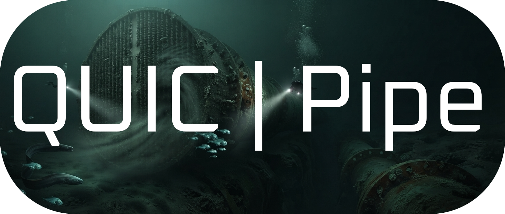

> [!WARNING]
> This project is **under active development**.
> Features may change or break at any moment. Use at your own risk!



<div align="center">

[](https://ko-fi.com/kernelpanic0x)
[](#-donations)

</div>

Create a unix pipe between two computers over an unstable connection.

`quicpipe` forwards stdin/stdout (or a file) from one machine to another over an **end-to-end encrypted QUIC connection**, surviving NATs, firewalls, and unstable links. The rendezvous happens over [magic-wormhole](https://github.com/magic-wormhole/magic-wormhole) — you only exchange a short human-readable code — while the data itself travels peer-to-peer via [iroh](https://github.com/n0-computer/iroh), with a relay fallback if a direct connection is not possible.

Because it behaves like a pipe, it composes with everything the unix shell already gives you:

```sh
producer | quicpipe inlet | consumer
```

Pipes that die like real pipes: `quicpipe` dies by `SIGPIPE`/`SIGINT` just like any other unix tool, so `producer | quicpipe inlet | consumer` behaves exactly as you'd expect — no wedged connections, no half-dead upstreams.

## 🔧 How it works

- **`quicpipe inlet`** — the sending side. Reads stdin (or a file) and streams it to the outlet. It accepts the connection and prints a wormhole code you pass to the other side.
- **`quicpipe outlet`** — the receiving side. Connects with the wormhole code and writes whatever arrives to stdout (or a file). Pass the code with `-c`, the `QUICPIPE_CODE` environment variable, or enter it interactively when prompted.

The wormhole code is only used to exchange the iroh endpoint addresses and public keys, securely and out-of-band. All pipe data flows directly between the two machines, end-to-end encrypted. If a direct connection fails, an encrypted relay is used automatically. Reconnects survive NAT rebinds and changing interfaces, so flaky links don't kill your transfer.

On the wire there are two streams per connection: a small framed control stream (resume offset, delivered-bytes acks, cancellation and fatal verdicts) and a raw byte stream carrying the source from the resume offset to EOF. There is no per-chunk offset or length framing — QUIC already delivers the data stream in order and intact. An XXH3-64 checksum is announced on the control stream when the source ends and verified by the outlet after every byte is written, so a resumed transfer can never pass as complete unless it reproduced the source exactly. The full contract — frames, close codes, resume and integrity rules — is in [PROTOCOL.md](PROTOCOL.md).

## 🚀 Usage

### Stream a file to another machine

On the sending machine (this prints a wormhole code, e.g. `7-crimson-otter`):

```sh
quicpipe inlet backup.tar.gz
```

On the receiving machine:

```sh
quicpipe outlet backup.tar.gz
```

### Stream a live command output

Anything you can pipe, you can send. On the sending side:

```sh
tar cz . | quicpipe inlet
```

On the receiving side:

```sh
quicpipe outlet | tar xz
```

### Work with files instead of stdin/stdout

Both sides accept a path argument instead of the default `-` (stdin/stdout):

```sh
# sending side
quicpipe inlet dump.sql

# receiving side
quicpipe outlet restored.sql
```

You can also set the wormhole code via the environment: `QUICPIPE_CODE`, and the rendezvous server via `WORMHOLE_MAILBOX_URL`.

### Progress and sizes

When stderr is a terminal, quicpipe shows a pv-style status line while it works:
connection state (`direct`, `via relay`, `connecting`, `reconnecting`), a progress
bar, throughput and ETA. Piped or `--quiet` output stays clean (stdout is always
reserved for pipe data).

The inlet auto-detects the size of a regular input file, and of stdin when it is
redirected from a regular file. For pipes, pass the size explicitly:

```sh
some-command | quicpipe inlet -s 2G
```

Suffixes are binary to match the bar: `k`/`Ki` = 1024, `M`/`Mi` = 1024², and so
on. The inlet sends the size to the outlet, so both sides show a total. The size
only drives progress and ETA; the end-to-end checksum remains the integrity check.

### Output control

Status and logs go to stderr (stdout is reserved for pipe data). By default the progress bar is the only status indication and library logs are silent; use `--quiet`/`-q` to also hide the bar, or set `RUST_LOG` for logs (e.g. `RUST_LOG=debug` also shows iroh's internals for troubleshooting).

## 🐚 Embedded in rescue-shell

`quicpipe` is also embedded as a subcommand in [rescue-shell](https://github.com/kernelPanic0x/rescue-shell) (`rescue-shell quicpipe ...`), so a rescue session always has a pipe available without installing anything else.

## 🏗️ Build from Source

```sh
git clone https://github.com/kernelPanic0x/quicpipe
cd quicpipe
cargo build --release
```

## 💖 Donations

<details>
<summary>USDT (BNB Smart Chain / BEP-20)</summary>
<div align="center">


**USDT (BNB Smart Chain / BEP-20)**: `0x29B0DF13a5AB3A5417107F3B980d4331b6DAE5C9`

</div>
</details>

<details>
<summary>Bitcoin (BTC)</summary>
<div align="center">


**Bitcoin (BTC)**: `bc1q3dztuw4qmmq6n5j2w5vuk8j60mmvzza3akanvs`

</div>
</details>

<details>
<summary>Monero (XMR)</summary>
<div align="center">


**Monero (XMR)**: `46ywULibU4KZEyufQSdD9jeM1Uo9gXm1jUxfNsk9TRy28LtQCrefdj5J762ifTNrY45YuUPf5BS5uWfdsHkiwy4mLA37poB`

</div>
</details>
